# Morah — Front-end

Front-end mobile do **Morah**, sistema de gestão de condomínios desenvolvido como projeto
acadêmico do 6º período de Engenharia de Software. Consome a API do `morah-backend` (contrato
`morah-openapi.yaml`, "Morah API — Gestão Condominial", v2.1.0), que é a fonte da verdade:
endpoints, campos, códigos HTTP e perfis seguem exatamente o contrato.

O app consome **54 das 55 operações** do contrato. A única que ele não chama é
`POST /financeiro/webhooks/pagamentos`, que é do gateway de pagamento.

## Autores

- _(preencher com os nomes dos alunos)_

## Stack

| Para quê | O que usamos |
|---|---|
| Base | Node 22, React 18 + TypeScript (strict) + Vite |
| Rotas | React Router |
| Busca de dados (cache, carregando, erro, recarregar) | TanStack Query |
| Estilo | CSS Modules + variáveis CSS, fonte Archivo (pacote local, sem Google Fonts) |
| Testes de unidade e componentes | Vitest + Testing Library + MSW |
| Testes de ponta a ponta | Playwright, contra o backend real |
| Qualidade | ESLint + `tsc --noEmit` |

As versões estão fixas no `package.json` e no `package-lock.json`. Não usamos biblioteca de
componentes, gerenciador de estado global nem gerador de código a partir do OpenAPI (o
contrato é 3.2): os tipos foram escritos à mão, com os mesmos nomes dos schemas.

## Como rodar

### 1. Backend (`morah-backend`)

```bash
mvn spring-boot:run
```

A API sobe em `http://localhost:8080/v1` (Swagger em `http://localhost:8080/v1/swagger-ui.html`).

- **Windows:** se o Tomcat falhar com `Unable to establish loopback connection`, defina a
  variável antes de subir: `JAVA_TOOL_OPTIONS=-Djdk.net.unixdomain.tmpdir=C:/Users/Public`
  (PowerShell: `$env:JAVA_TOOL_OPTIONS="-Djdk.net.unixdomain.tmpdir=C:/Users/Public"`).
- O comando `mvn` precisa estar no PATH (o teste de ponta a ponta também o usa).

### 2. Front-end

```bash
npm ci
npm run dev
```

O app abre em `http://localhost:5173`. Para ver como celular no navegador, use o modo
dispositivo (390 × 844).

**Sem CORS no backend.** O front sempre chama o caminho relativo `/v1/...` e o Vite repassa a
chamada para o backend (`server.proxy` no `npm run dev` e `preview.proxy` no `npm run preview`).
O destino vem da variável `API_TARGET` (padrão `http://localhost:8080`). Se o front for publicado
em outro domínio, o backend precisará liberar CORS.

### Scripts

| Script | O que faz |
|---|---|
| `npm run dev` | servidor de desenvolvimento |
| `npm run build` | checagem de tipos + build de produção em `dist/` |
| `npm run preview` | serve o build (com o mesmo proxy) |
| `npm run lint` | ESLint (zero avisos) |
| `npm run typecheck` | `tsc --noEmit` |
| `npm test` | testes de unidade e componentes (Vitest) |
| `npm run e2e` | testes de ponta a ponta (Playwright) contra o backend real |

## Usuários de demonstração

Todos com a senha `demo123`. Em `npm run dev`, a tela de login tem um bloco recolhido
"Usuários de demonstração" que preenche e-mail e senha (o bloco não existe no build de produção).

| E-mail | Pessoa | Perfil | Unidade |
|---|---|---|---|
| `helena.prado@demo.com.br` | Helena Prado | síndico | — |
| `rafael.nunes@demo.com.br` | Rafael Nunes | proprietário | Apto 302 (id 1, Bloco A id 1) |
| `camila.duarte@demo.com.br` | Camila Duarte | morador | Apto 502 (id 2, Bloco B id 2) |
| `portaria@demo.com.br` | Portaria Central | portaria | — |

## Testes

### Unidade e componentes (`npm test`)

Vitest + Testing Library, com as chamadas à API simuladas pelo MSW. **Todos os handlers ficam
em um único arquivo**, `src/testes/handlers.ts`, montados a partir dos exemplos e schemas do
contrato. Cobrem:

- `ApiClient`: Bearer e `/v1`, erro RFC 9457 (`detail` e `erros`), 401 → um refresh → repete
  uma vez, **várias chamadas com 401 ao mesmo tempo geram um único refresh**, refresh recusado
  limpa a sessão, `getInstance()` devolve sempre o mesmo objeto;
- `Logger` (níveis e que não registra tokens nem senhas);
- sessão (login, logout, troca de contexto, `localStorage`) e guardas de rota (perfil e módulo);
- formatadores (moeda, data, hora, período) e rótulos (todo valor de enum do contrato tem rótulo);
- cores como variáveis CSS e escolha do texto claro/escuro por contraste;
- cada formulário (validação do cliente + erros do servidor) e cada tela principal nos estados
  carregando, vazio, erro e sucesso.

### Ponta a ponta (`npm run e2e`)

Playwright no Chromium com celular emulado (`isMobile` e `hasTouch`): **390 × 844** roda a
suíte completa e **360 × 800** roda a fumaça (login e todas as abas de cada perfil).

O `playwright.config.ts` sobe tudo sozinho:

- o **backend** em `../morah-backend` (outra pasta pela variável `MORAH_BACKEND_DIR`), com
  `mvn -q spring-boot:run`, porta **8081** e banco isolado `target/e2e.db`, apagado a cada
  execução (`e2e/iniciar-backend.mjs`; no Windows ele já define o `JAVA_TOOL_OPTIONS`);
- o **front** compilado (`npm run build` + `vite preview` na porta 4173) com
  `API_TARGET=http://localhost:8081`;
- espera o backend responder 200 em `/v1/swagger-ui/index.html` antes de começar.

Regras dos testes (em `e2e/apoio.ts`):

- todo teste entra pela tela de login (nada de injetar token) e cria os próprios dados
  (títulos, competências e dias únicos por execução);
- em **todas** as telas visitadas são verificados automaticamente: sem rolagem horizontal
  (`scrollWidth <= innerWidth`), sem erro no console e sem requisição com falha; um 4xx
  esperado (por exemplo o 409 de um conflito) é declarado no próprio teste.

| Arquivo | Fluxos |
|---|---|
| `login.spec.ts` | 4 perfis entram e veem suas abas; senha errada; logout + "voltar" do navegador; sessão ao recarregar; troca de contexto; refresh transparente sem access token; os dois tokens inválidos voltam ao login |
| `notificacoes.spec.ts` | selo do sino, tocar marca como lida e o selo diminui |
| `personalizacao.spec.ts` | cores e nome refletem na hora e persistem; cor inválida; remover logo; desligar Encomendas some a aba, a rota direta mostra "Módulo indisponível" e o painel esconde a seção |
| `avisos.spec.ts` | publicar → não lido → lido → editar só o título → expirar → 410 para a moradora; aviso de unidade não aparece para outra unidade |
| `financeiro.spec.ts` | taxas igualitária e por fração ideal, falhas ao gerar de novo; PIX e copiar; baixa manual e 409 no PIX; inadimplência; documento |
| `minha-unidade.spec.ts` | cadastrar e encerrar inquilino; solicitar vínculo, aprovar e 409 na segunda decisão; unidade inexistente; morador sem a tela de inquilinos |
| `portaria.spec.ts` | visitante → autorização → entrada → saída; conflito de decisão; reenviar só pendente; unidade inexistente; síndico consulta acessos |
| `reservas.spec.ts` | reservar; conflito no mesmo horário; cancelar; vistoria com dano e de saída; síndico vê todas |
| `encomendas.spec.ts` | registrar → notificação → código errado e certo; retirada por terceiro; extravio; unidade inexistente |
| `dashboard.spec.ts` | painéis dos três perfis, cartões levam aos módulos |
| `perfis.spec.ts` | cada perfil não vê nem abre pela URL o que não é seu; proprietário abre as telas de morador |
| `fumaca.spec.ts` | (360 × 800) cada perfil percorre todas as abas |

### Capturas de tela

As capturas abaixo são geradas pelo Playwright (`e2e/capturas.spec.ts`), que só roda quando pedido:

```bash
CAPTURAS=1 npx playwright test e2e/capturas.spec.ts
```

No PowerShell: `$env:CAPTURAS=1; npx playwright test e2e/capturas.spec.ts`.

## Arquitetura em 3 camadas

```
páginas  →  hooks  →  api
(telas)     (TanStack Query)   (funções tipadas que usam o ApiClient)
```

- Uma página nunca chama `fetch`; um hook nunca monta JSX; a api nunca conhece React.
- Toda requisição passa pelo **mesmo** cliente HTTP (`ApiClient`); cada endpoint é uma função
  tipada em `src/api/`.

```
src/
  api/          ApiClient (Singleton) + 1 arquivo por área: autenticacaoApi.ts, avisosApi.ts, ...
  tipos/        1 arquivo por área com os tipos do contrato (nomes iguais aos schemas)
  hooks/        1 arquivo por área: useCobrancas(), useCriarReserva(), ...; clienteQuery.ts; paginacao.ts
  paginas/      1 pasta por área; cada tela é um componente (CobrancasPage, NovaReservaPage, ...)
  componentes/  Tela, BarraAbas, Cartao, Selo, Campo, Botao, BottomSheet, Toast, Estados, ListaAtalhos...
  contexto/     SessaoContext (tokens, contexto ativo, perfil) e TemaContext (identidade visual e módulos)
  rotas/        Rotas.tsx (tabela de telas), RotaProtegida.tsx (guardas), navegacao.ts (abas e "Mais")
  utils/        formatadores, rótulos dos enums, cores, alterações do PATCH e o Logger (Singleton)
  testes/       handlers do MSW, servidor e o renderizar() usado nos testes
e2e/            testes de ponta a ponta e o apoio (verificações automáticas, login, dados)
```

### Os 2 padrões de projeto (ambos Singleton)

| Classe | Onde | Problema que resolve |
|---|---|---|
| `ApiClient` | `src/api/ApiClient.ts` | Uma única instância guarda os tokens, monta as requisições (`/v1`, Bearer, JSON), transforma o erro RFC 9457 em `ErroApi` e faz o refresh. O refresh é **rotativo** (cada refresh invalida o anterior): com uma instância só, todas as requisições que recebem 401 ao mesmo tempo esperam a **mesma** chamada de refresh, em vez de uma invalidar a outra. |
| `Logger` | `src/utils/logger.ts` | Um único ponto para ligar/desligar e formatar os logs (`debug`, `info`, `warn`, `error`). Em produção só `warn` e `error`; tokens e senhas viram `***`. |

Os dois têm construtor privado e `getInstance()`.

### Como os dados chegam numa tela (exemplo)

1. `CobrancasPage` chama `useCobrancas(filtros)` (`hooks/financeiroHooks.ts`).
2. O hook usa o TanStack Query, que chama `buscarCobrancas()` (`api/financeiroApi.ts`).
3. A função chama `ApiClient.getInstance().get('/financeiro/cobrancas', ...)`.
4. A tela mostra o estado certo com `<EstadoConsulta>`: carregando, erro (com "Tentar de novo"),
   vazio ou os dados.

## Identidade visual

O visual foi feito com o guia de design `frontend-design` (skill da Anthropic):

- As três cores (primária, secundária, destaque) **são do condomínio** e o síndico as troca
  na hora. Por isso a identidade do app vem da tipografia e da estrutura, não de uma paleta fixa.
- **A barra do topo é a "placa do prédio":** cor primária, nome do condomínio e o título da
  tela na fonte Archivo larga e pesada. A placa da unidade ("Apto 302") repete a ideia.
- O resto fica quieto: listas agrupadas com linhas finas (em vez de cartões soltos com sombra),
  selo de status com ponto colorido **e** texto, cantos com hierarquia (grupo 14 px, campo 10 px,
  selo 6 px) e textos em frases simples.
- As cores ficam em variáveis CSS (`--cor-primaria`, `--cor-secundaria`, `--cor-destaque` e o
  texto legível sobre cada uma, escolhido por contraste WCAG em `utils/cores.ts`).

## Tela → endpoints → arquivo

As 54 operações consumidas. "Arquivo" é a função em `src/api/` (e a tela em `src/paginas/`).

| Tela (arquivo em `src/paginas/`) | Endpoint | Função (`src/api/`) |
|---|---|---|
| Entrar (`login/LoginPage`) | `POST /auth/login` | `autenticacaoApi.entrar` |
| Perfil (`login/PerfilPage`) | `GET /auth/me` | `autenticacaoApi.buscarMe` |
| Trocar perfil (`login/TrocarPerfilPage`) | `POST /auth/contexto` | `autenticacaoApi.trocarContexto` |
| (qualquer tela, ao receber 401) | `POST /auth/refresh` | `ApiClient` (refresh compartilhado) |
| Perfil (`login/PerfilPage`) | `POST /auth/logout` | `autenticacaoApi.sair` |
| Início (`inicio/InicioPage`) | `GET /home/dashboard` | `dashboardApi.buscarDashboard` |
| Cobranças (`financeiro/CobrancasPage`) | `GET /financeiro/cobrancas` | `financeiroApi.buscarCobrancas` |
| Detalhe da cobrança (`financeiro/DetalheCobrancaPage`) | `GET /financeiro/cobrancas/{id}` | `financeiroApi.buscarCobranca` |
| PIX (`financeiro/PixPage`) | `GET /financeiro/cobrancas/{id}/pix` | `financeiroApi.gerarPix` |
| Baixa manual (`financeiro/DetalheCobrancaPage`) | `POST /financeiro/cobrancas/{id}/baixa-manual` | `financeiroApi.baixarCobrancaManualmente` |
| Documentos (`financeiro/DocumentosPage`) | `GET /financeiro/documentos` | `financeiroApi.buscarDocumentosFinanceiros` |
| Publicar documento (`financeiro/NovoDocumentoPage`) | `POST /financeiro/documentos` | `financeiroApi.criarDocumentoFinanceiro` |
| Taxas e cobranças (`financeiro/TaxasPage`) | `POST /financeiro/taxas` | `financeiroApi.criarTaxa` |
| Taxas e cobranças (`financeiro/TaxasPage`) | `POST /financeiro/taxas/{id}/gerar-cobrancas` | `financeiroApi.gerarCobrancasEmLote` |
| Inadimplência (`financeiro/InadimplenciaPage`) | `GET /financeiro/inadimplencia` | `financeiroApi.buscarInadimplencia` |
| Registrar visitante (`portaria/RegistrarVisitantePage`) | `POST /portaria/visitantes` | `portariaApi.registrarVisitante` |
| Visitantes (`portaria/AutorizacoesPage`) | `GET /portaria/autorizacoes` | `portariaApi.buscarAutorizacoes` |
| Visita (`portaria/AutorizacaoPage`) | `GET /portaria/autorizacoes/{id}` | `portariaApi.buscarAutorizacao` |
| Visita (`portaria/AutorizacaoPage`) | `PATCH /portaria/autorizacoes/{id}/decisao` | `portariaApi.decidirAutorizacao` |
| Visita (`portaria/AutorizacaoPage`) | `POST /portaria/autorizacoes/{id}/reenviar` | `portariaApi.reenviarAutorizacao` |
| Histórico de acessos (`portaria/AcessosPage`) | `GET /portaria/acessos` | `portariaApi.buscarAcessos` |
| Visita (entrada) e Histórico (saída) | `POST /portaria/acessos` | `portariaApi.registrarAcesso` |
| Mural (`avisos/MuralPage`) | `GET /avisos` | `avisosApi.buscarAvisos` |
| Novo aviso (`avisos/NovoAvisoPage`) | `POST /avisos` | `avisosApi.criarAviso` |
| Aviso (`avisos/AvisoPage`) e Editar (`avisos/EditarAvisoPage`) | `GET /avisos/{id}` | `avisosApi.buscarAviso` |
| Editar aviso (`avisos/EditarAvisoPage`) | `PATCH /avisos/{id}` | `avisosApi.alterarAviso` |
| Aviso (`avisos/AvisoPage`) | `DELETE /avisos/{id}` | `avisosApi.deletarAviso` |
| Áreas comuns (`reservas/AreasComunsPage`) e Nova reserva | `GET /areas-comuns` | `reservasApi.buscarAreasComuns` |
| Nova reserva (`reservas/NovaReservaPage`) | `GET /areas-comuns/{id}/disponibilidade` | `reservasApi.buscarDisponibilidade` |
| Reservas (`reservas/ReservasPage`) | `GET /reservas` | `reservasApi.buscarReservas` |
| Nova reserva (`reservas/NovaReservaPage`) | `POST /reservas` | `reservasApi.criarReserva` |
| Reserva (`reservas/DetalheReservaPage`) | `GET /reservas/{id}` | `reservasApi.buscarReserva` |
| Reserva (`reservas/DetalheReservaPage`) | `DELETE /reservas/{id}` | `reservasApi.deletarReserva` |
| Vistoria (`reservas/VistoriaPage`) | `POST /reservas/{id}/vistoria` | `reservasApi.registrarVistoria` |
| Minha unidade (`minhaUnidade/MinhaUnidadePage`) | `GET /unidades/minha` | `minhaUnidadeApi.buscarMinhaUnidade` |
| Minha unidade e Inquilinos | `GET /unidades/minha/vinculos` | `minhaUnidadeApi.buscarVinculosMinhaUnidade` |
| Solicitar vínculo (`minhaUnidade/SolicitarVinculoPage`) | `POST /unidades/minha/vinculos/solicitacoes` | `minhaUnidadeApi.solicitarVinculo` |
| Cadastrar inquilino (`minhaUnidade/CadastrarInquilinoPage`) | `POST /unidades/minha/inquilinos` | `minhaUnidadeApi.criarInquilino` |
| Inquilinos (`minhaUnidade/InquilinosPage`) | `DELETE /unidades/minha/inquilinos/{id}` | `minhaUnidadeApi.deletarInquilino` |
| Veículos (`minhaUnidade/VeiculosPage`) | `GET /unidades/minha/veiculos` | `minhaUnidadeApi.buscarVeiculos` |
| Veículos (`minhaUnidade/VeiculosPage`) | `DELETE /unidades/minha/veiculos/{id}` | `minhaUnidadeApi.deletarVeiculo` |
| Cadastrar veículo (`minhaUnidade/FormularioVeiculoPage`) | `POST /unidades/minha/veiculos` | `minhaUnidadeApi.criarVeiculo` |
| Editar veículo (`minhaUnidade/FormularioVeiculoPage`) | `PATCH /unidades/minha/veiculos/{id}` | `minhaUnidadeApi.alterarVeiculo` |
| Unidades (`minhaUnidade/UnidadesPage`) | `GET /unidades/{id}` | `minhaUnidadeApi.buscarUnidade` |
| Unidades (`minhaUnidade/UnidadesPage`) | `GET /unidades/{id}/vinculos/solicitacoes` | `minhaUnidadeApi.buscarSolicitacoesVinculo` |
| Unidades (`minhaUnidade/UnidadesPage`) | `PATCH /unidades/{id}/vinculos/solicitacoes/{id}` | `minhaUnidadeApi.decidirSolicitacaoVinculo` |
| Encomendas (`encomendas/EncomendasPage`) | `GET /encomendas` | `encomendasApi.buscarEncomendas` |
| Registrar encomenda (`encomendas/RegistrarEncomendaPage`) | `POST /encomendas` | `encomendasApi.registrarEncomenda` |
| Encomenda (`encomendas/DetalheEncomendaPage`) | `GET /encomendas/{id}` | `encomendasApi.buscarEncomenda` |
| Autorizar retirada (`encomendas/AutorizarTerceiroPage`) | `POST /encomendas/{id}/autorizacoes-retirada` | `encomendasApi.autorizarRetiradaTerceiro` |
| Confirmar retirada (`encomendas/RetiradaPage`) | `POST /encomendas/{id}/retirada` | `encomendasApi.confirmarRetirada` |
| Informar extravio (`encomendas/ExtravioPage`) | `POST /encomendas/{id}/ocorrencias` | `encomendasApi.abrirOcorrencia` |
| Notificações (`notificacoes/NotificacoesPage`) e sino | `GET /notificacoes` | `notificacoesApi.buscarNotificacoes` |
| Notificações (`notificacoes/NotificacoesPage`) | `PATCH /notificacoes/{id}/lida` | `notificacoesApi.marcarNotificacaoLida` |
| Todas (tema) e Identidade visual (`personalizacao/IdentidadeVisualPage`) | `GET /condominio/personalizacao` | `personalizacaoApi.buscarPersonalizacao` |
| Identidade visual (`personalizacao/IdentidadeVisualPage`) | `PATCH /condominio/personalizacao` | `personalizacaoApi.alterarPersonalizacao` |
| Todas (abas e rotas) e Módulos (`personalizacao/ModulosPage`) | `GET /condominio/modulos` | `personalizacaoApi.buscarModulos` |
| Módulos (`personalizacao/ModulosPage`) | `PATCH /condominio/modulos/{modulo}` | `personalizacaoApi.alterarModulo` |

## Decisões tomadas por simplicidade

- **Tokens no `localStorage`.** É a única cópia (o `ApiClient` lê de lá a cada requisição), então
  recarregar a página mantém a sessão. Num produto real, um cookie `HttpOnly` seria mais seguro.
- **Refresh:** em 401 de rota autenticada o `ApiClient` faz **um** refresh (compartilhado entre as
  requisições que receberam 401 juntas) e repete a requisição **uma** vez; refresh recusado limpa
  a sessão e volta ao login. Logout limpa a sessão local mesmo se a chamada falhar.
- **Trocar perfil:** a opção aparece em "Mais" e no Perfil só com mais de um vínculo; a rota
  `/perfil/trocar` existe para todos. Ao trocar, o cache do TanStack Query é limpo.
- **Módulos:** enquanto a lista de módulos não chega (ou se falhar), o módulo conta como ativo
  — o backend continua respondendo 403. Um 403 "Módulo X desativado" mostra "Módulo indisponível"
  e recarrega a lista de módulos.
- **Sem listagem de unidades, blocos, taxas e ocorrências no contrato:** onde é preciso, a tela
  pede o **ID** da unidade ou do bloco (404 = "Unidade não encontrada"). As taxas criadas ficam só
  na memória da tela de taxas (`useState`), para oferecer "Gerar cobranças" com o id devolvido.
- **Arquivos e fotos são URLs de texto** (`fotoUrl`, `arquivoUrl`, `logoUrl`, `fotosUrl`): não há upload.
- **PATCH parcial:** o formulário compara o que mudou (`utils/alteracoes.ts`) e envia só esses
  campos. `JSON.stringify` descarta `undefined` e mantém `null`: assim "Remover logo" envia
  `"logoUrl": null` e os outros campos nem aparecem.
- **Notificações:** sem contagem total no contrato, o selo do sino conta as não lidas da primeira
  página ("9+" acima de 9) e se atualiza a cada 30 s; a lista considera que há mais páginas quando
  a última veio cheia.
- **Filtros:** os de cobranças ficam na URL (voltar do detalhe mantém o filtro); nas outras telas,
  em estado local. Datas "do dia" (reservas, acessos) usam a data do aparelho.
- **Reserva:** a pessoa toca no horário de início e depois no último horário (só horários livres e
  seguidos); o app envia os instantes exatamente como vieram da disponibilidade.
- **`tipo` do documento e `meio` da baixa** são texto livre no contrato; o app oferece valores
  sugeridos (`nota_fiscal`, `prestacao_contas`, ...; `transferencia`, `pix`, ...).
- **Atualização automática desligada ao voltar o foco** (`refetchOnWindowFocus: false`): no celular
  as telas buscam dados ao abrir; o sino é a única coisa que se atualiza sozinha.
- **Vitest com 2 processos** (`maxWorkers: 2`): no Windows, muitos processos lendo `node_modules`
  ao mesmo tempo às vezes falham ao abrir arquivos.

## Melhorias sugeridas para o backend

- **CORS:** hoje o front depende do proxy do Vite. Publicado em outro domínio, o backend
  precisará liberar CORS para a origem do app.
- **Listagens que faltam:** unidades, blocos, taxas e ocorrências. Com elas, as telas trocariam o
  campo "ID da unidade/bloco" por uma lista e as taxas não ficariam só na memória da tela.
- **Upload de arquivos:** fotos, documentos e logo hoje são URLs digitadas.
- **Contagem de notificações não lidas:** um campo com o total evitaria contar só a primeira página.
- **Travamento ao trocar módulos:** o `CacheModulosAtivos` lê o banco **dentro** do
  `computeIfAbsent` (segurando o lock do mapa) e o pool tem **uma** conexão. Logo depois de o
  síndico ligar/desligar um módulo, se uma rota de módulo e o `/home/dashboard` chegam juntos, um
  espera o lock e o outro a conexão, e o backend fica ~30 s parado. Sugestão: carregar fora do
  `computeIfAbsent` (ou usar um pool maior). Os testes de ponta a ponta contornam isso com uma
  chamada sozinha a uma rota de módulo logo após cada troca (`aquecerCacheDeModulos`).

## Capturas de tela (390 × 844)

| | | |
|---|---|---|
| 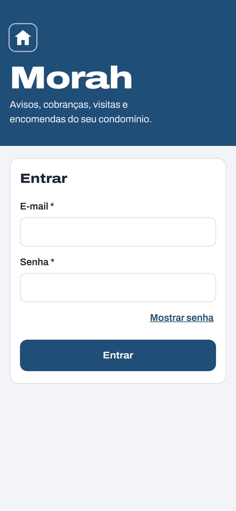 Login | 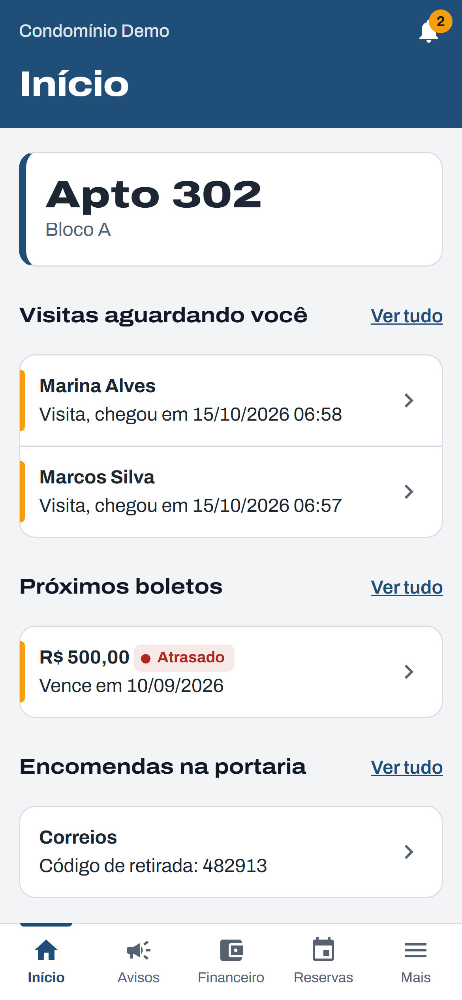 Início (proprietário) | 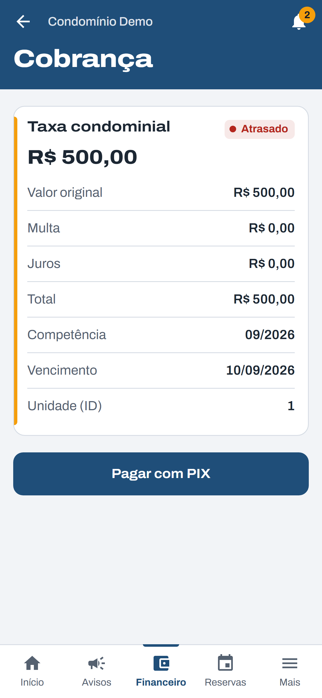 Cobrança |
| 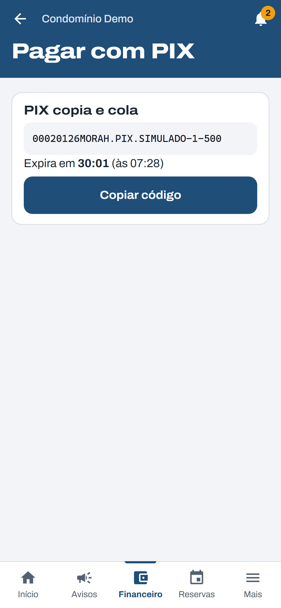 PIX | 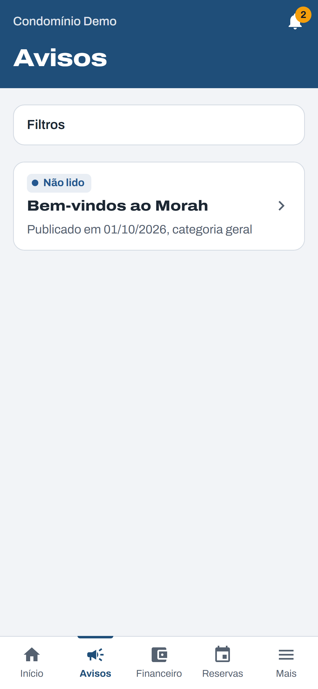 Avisos | 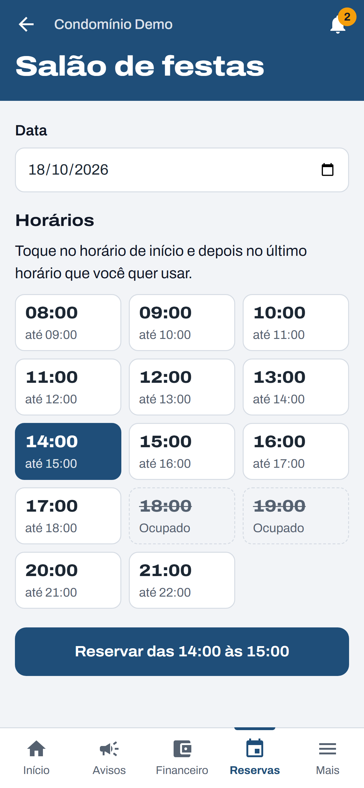 Nova reserva |
| 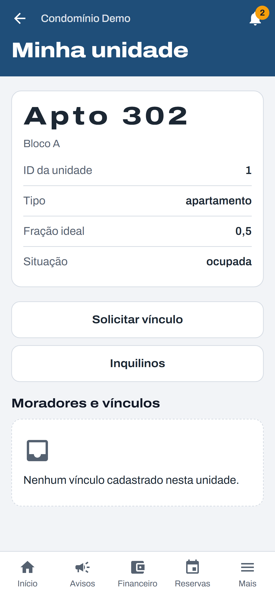 Minha unidade | 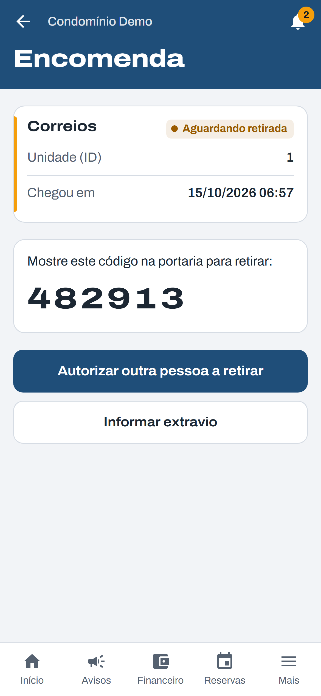 Encomenda | 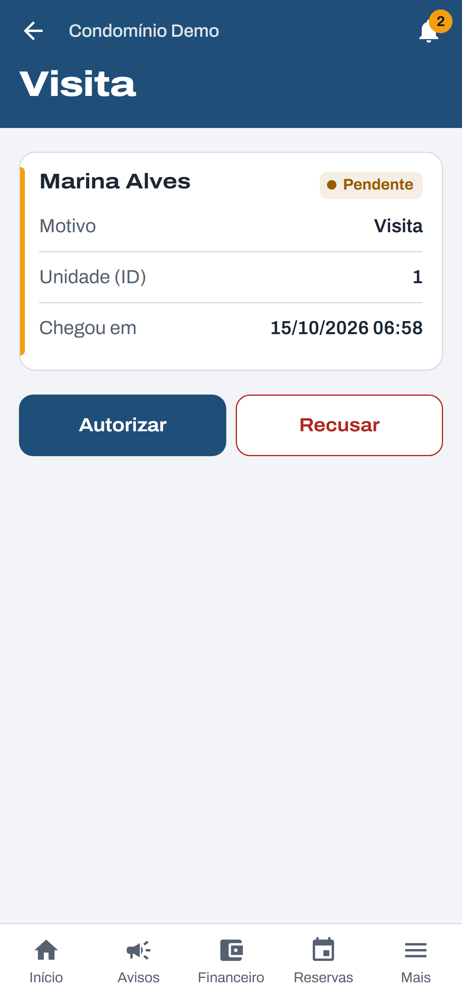 Visita |
| 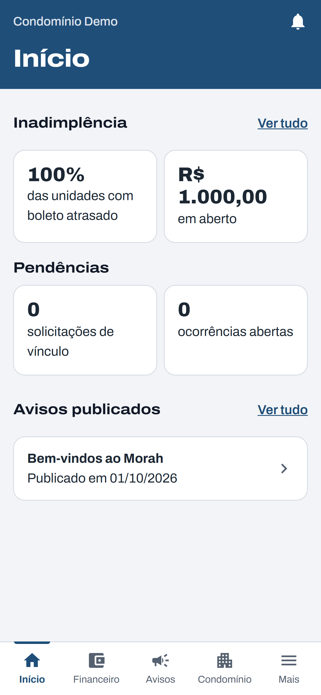 Início (síndica) | 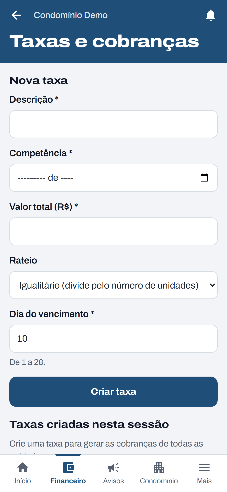 Taxas | 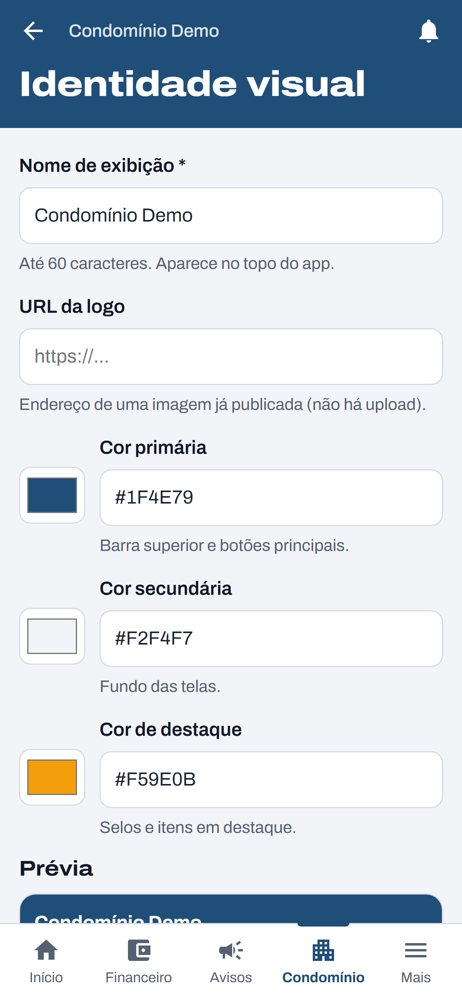 Identidade visual |
| 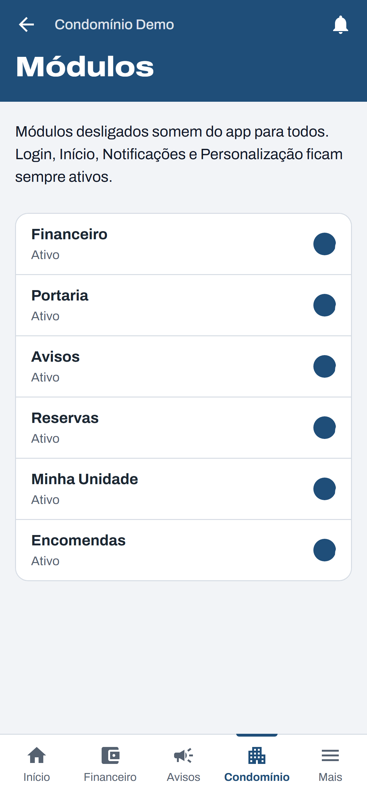 Módulos | 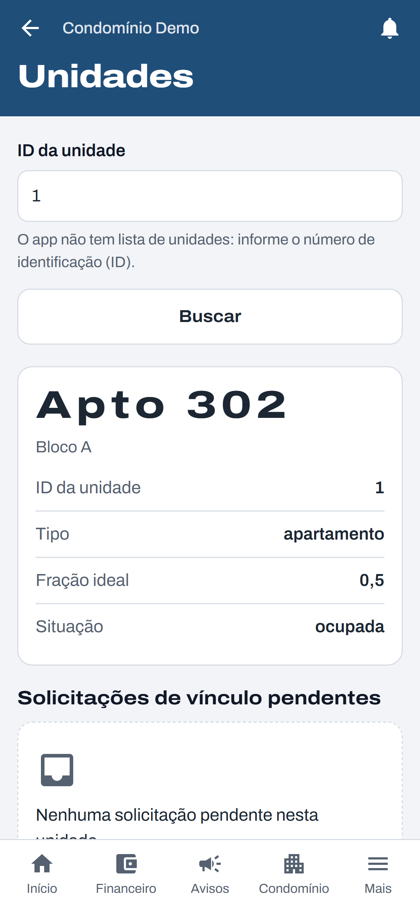 Unidades | 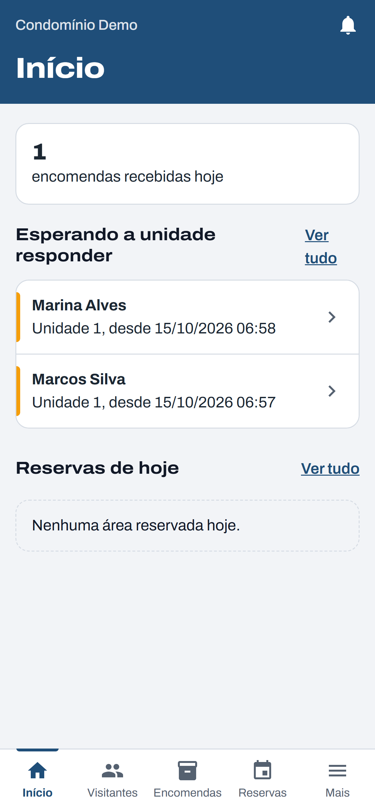 Início (portaria) |
| 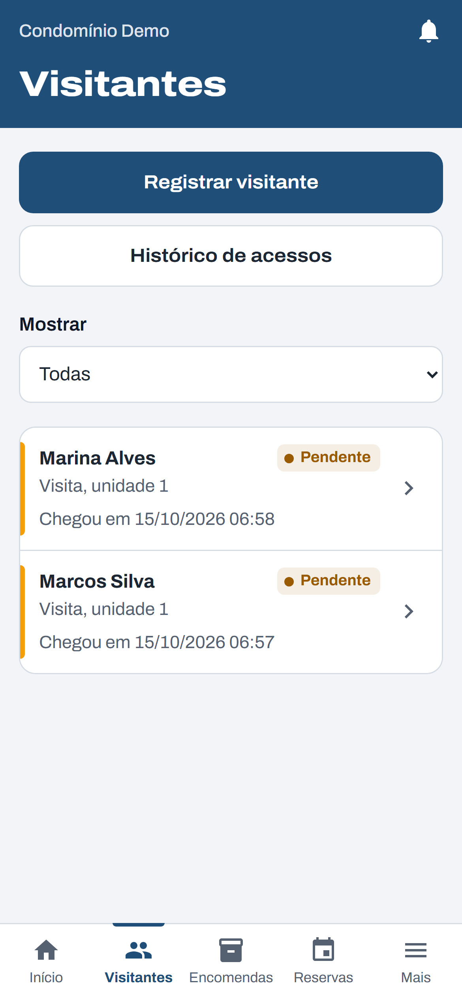 Visitantes | 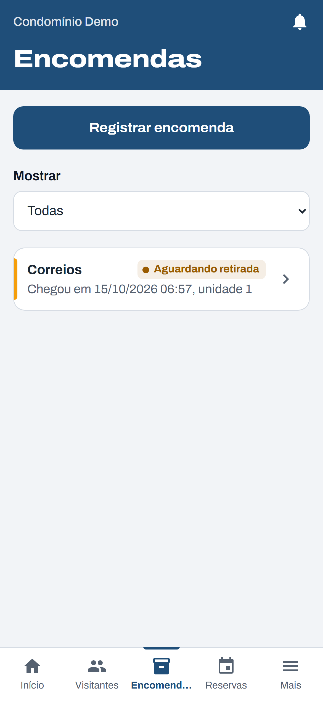 Encomendas | 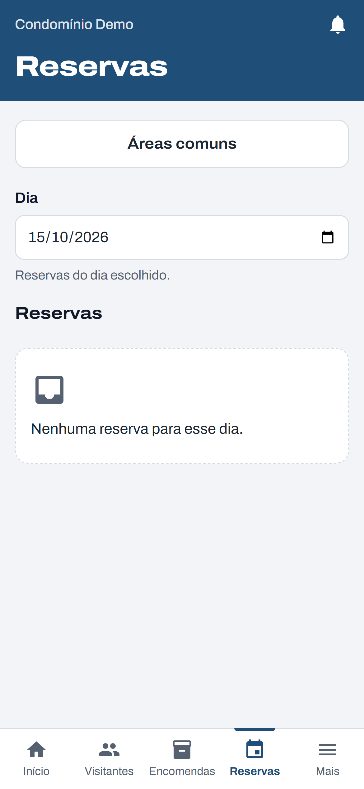 Reservas do dia |
| 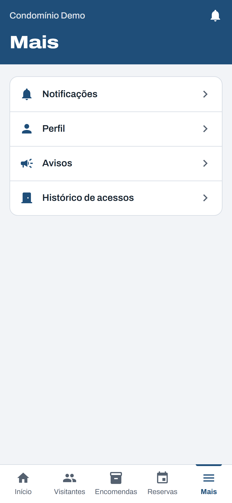 Mais | 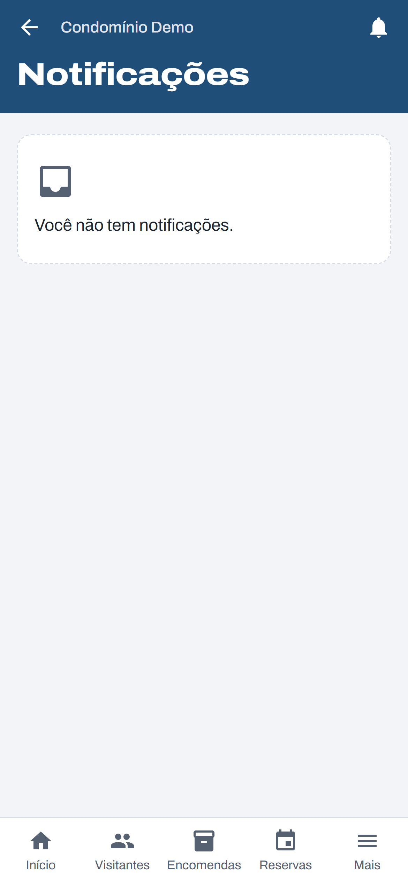 Notificações | |
